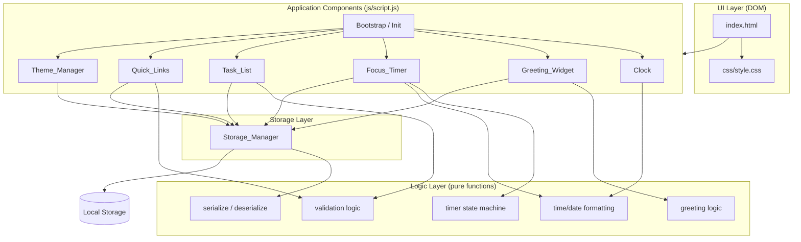
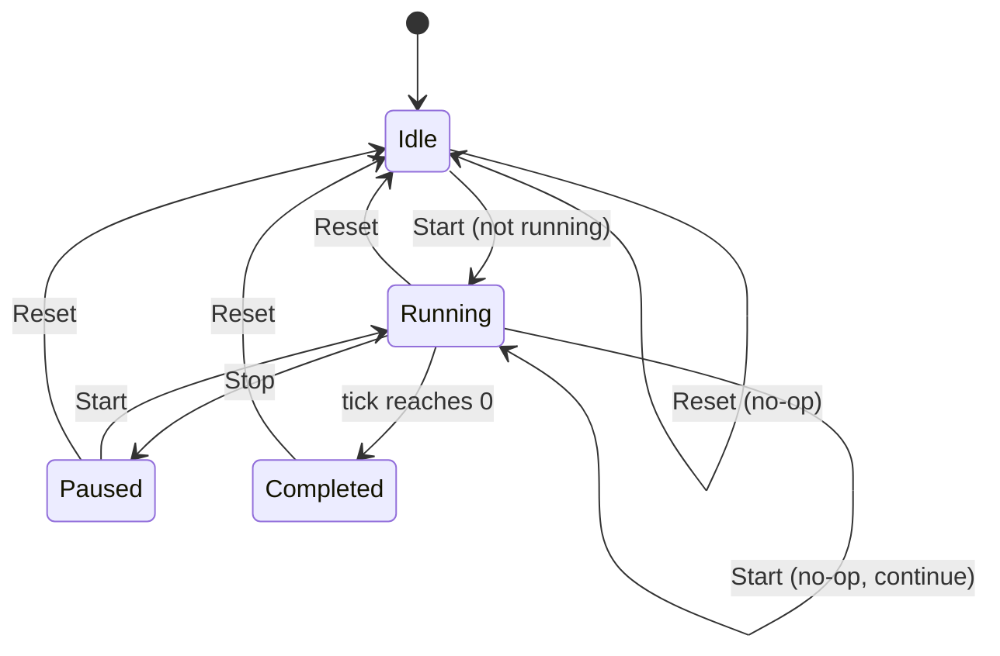

# Design Document

## Overview

The To-Do List Life Dashboard is a single-page, client-side web application built with HTML, CSS, and Vanilla JavaScript (no external frameworks). It provides a personal productivity dashboard combining a live clock, a time-based greeting, a Pomodoro-style focus timer, a to-do task list, and quick links to favorite websites. All user data and application state persist in the browser via the Local Storage API, so the application requires no backend server and runs by opening `index.html` in any modern browser.

The design organizes the application into a small set of focused components, each owning a region of the UI and a well-defined piece of logic. A shared `Storage_Manager` handles all serialization, deserialization, and persistence. The logic that can be expressed as pure functions (greeting determination, input validation, serialization, timer state, and time formatting) is isolated from DOM manipulation and Local Storage I/O so that it can be verified with property-based tests, while the UI and storage layers are verified with example-based and integration tests.

### Scope

This design addresses all 12 requirements: time and date display, time-based greeting, custom name, focus timer, custom focus duration, to-do list management, quick links management, light/dark theme toggle, data persistence and serialization, browser compatibility and technology stack, project structure, and performance and visual design.

### Design Decisions and Rationale

1. **Layered separation of pure logic from I/O and DOM.** The application separates pure functions (validation, serialization, greeting, formatting, timer state transitions) from side-effectful code (DOM rendering, Local Storage access, timers). Rationale: the pure layer is the only part that meaningfully varies with input and is cost-effective to test across a large input space, making it the right target for property-based testing. The I/O and DOM layers are tested with representative examples and integration tests instead.

2. **Single-file JavaScript with module pattern.** Per Requirement 11, all JavaScript lives in `js/script.js`. The file uses an IIFE / module-revealing pattern to namespace each component, avoiding global pollution while staying within the "no bundler, no framework" constraint. Rationale: keeps the build toolchain-free while preserving readability and maintainability.

3. **Storage availability detection at startup.** Local Storage can throw `QuotaExceededError` on writes when the quota is exceeded or when the browser is in private/incognito mode (notably Safari). The application performs a feature-detection probe write at startup and wraps every storage operation in try/catch. On failure, it keeps current data in memory and surfaces a non-blocking error message. Rationale: graceful degradation in private browsing and quota-exhausted states, as required by Requirements 8.5, 9.5, and 10.4.

4. **Separate storage keys per data type.** Tasks, links, and settings are stored under independent keys (`tld_tasks`, `tld_links`, `tld_settings`). Rationale: a corruption or write failure in one data type does not affect the others, and each component can load and save independently.

5. **ID generation via `crypto.randomUUID()` with fallback.** Task and link IDs use the native `crypto.randomUUID()` where available, falling back to a timestamp-plus-random string for older browsers. Rationale: stable, collision-resistant identifiers without a dependency.

6. **Two valid ranges for focus duration.** The `Focus_Timer` countdown logic can count down any duration from 1 to 999 minutes (Requirement 4.6), while the user-facing "custom focus duration" input is constrained to 1 to 120 minutes (Requirement 5). Rationale: keeps the timer component general while the user input validation enforces the tighter, intended range.

## Architecture

The application is a single-page client-side app with no server communication. The browser loads `index.html`, which links `css/style.css` for styling and `js/script.js` for all logic. On load, a bootstrap routine initializes each component, loads persisted state from Local Storage, and wires DOM event listeners. After initialization, the application is event-driven: user interactions trigger component logic, which updates in-memory state, re-renders the affected DOM region, and persists changes through the `Storage_Manager`.

### Layered Architecture

The code is organized into three logical layers:

- **UI Layer** — DOM structure, rendering, and event handling. Each component owns a DOM region and exposes methods to render its state and bind user events.
- **Logic Layer** — Pure functions with no side effects: greeting determination, input validation, time/date formatting, serialization/deserialization, and focus-timer state transitions. These are the primary targets for property-based testing.
- **Storage Layer** — The `Storage_Manager`, which owns all interaction with the Local Storage API: availability detection, JSON serialization/deserialization, and read/write with error handling.

### Component Architecture Diagram



### Data Flow

Data flows in two directions:

- **User action → state → render → persist.** A user interaction (e.g., adding a task) triggers the component's handler. The handler validates input through pure validation functions, updates in-memory state, re-renders the DOM region, and calls `Storage_Manager.save()`, which serializes to JSON and writes to Local Storage.
- **Load → deserialize → state → render.** On startup, each component calls `Storage_Manager.load()` for its key. The `Storage_Manager` reads the JSON string from Local Storage, deserializes it, and validates the structure. The component applies the loaded data (or defaults on failure) and renders its region.

### Focus Timer State Machine

The focus timer operates as a finite state machine driven by Start, Stop, and Reset buttons and a 1-second tick.



## Components and Interfaces

Each component is implemented as a module within `js/script.js` using the revealing module pattern. The interfaces below define the public functions and the pure helper functions they depend on.

### Clock

Displays the current time in 24-hour format and the full date, updating every second without reloading the page (Requirements 1.1–1.3).

**Public interface:**
- `Clock.init()` — Binds the clock DOM elements and starts a 1-second update interval.
- `Clock.start()` — Starts the `setInterval` that calls `update()` every second.
- `Clock.update()` — Reads the current `Date`, formats it, and writes the time and date strings to the DOM.

**Pure helper functions (Logic Layer):**
- `formatTime(date: Date): string` — Returns `"HH:MM:SS"` in 24-hour format with zero-padded fields.
- `formatDate(date: Date): string` — Returns `"Weekday, D Month YYYY"` using the full weekday and month names.

### Greeting_Widget

Displays a time-of-day greeting based on the user's local hour and an optional custom name (Requirements 2 and 3).

**Public interface:**
- `Greeting_Widget.init()` — Loads the saved custom name, evaluates the greeting, and renders.
- `Greeting_Widget.update()` — Reads the current local hour, computes the greeting, and renders it alongside the custom name (if present).
- `Greeting_Widget.setCustomName(name: string): { valid: boolean, error?: string }` — Validates the name, saves it via `Storage_Manager` on success, and re-renders. Returns a validation result.

**Pure helper functions (Logic Layer):**
- `getGreeting(hour: number): string` — Maps an hour (0–23) to one of `"Good Morning"`, `"Good Afternoon"`, `"Good Evening"`, `"Good Night"` per the time ranges in Requirement 2.
- `validateCustomName(name: string): { valid: boolean, error?: string }` — Accepts 1–50 characters; rejects empty, whitespace-only, and over-50-character inputs.

### Focus_Timer

Provides a Pomodoro-style countdown with Start, Stop, and Reset controls (Requirement 4). Countdown logic handles durations of 1–999 minutes; the user-facing custom duration is constrained to 1–120 minutes by Requirement 5.

**Public interface:**
- `Focus_Timer.init()` — Loads the saved focus duration, applies defaults if invalid, and renders the initial display.
- `Focus_Timer.start()` — If not already running, begins the countdown at 1-second intervals. If already running, does nothing (Requirement 4.7).
- `Focus_Timer.stop()` — Pauses the countdown and retains remaining time.
- `Focus_Timer.reset()` — Resets the remaining time to the configured focus duration and stops the countdown.
- `Focus_Timer.setDuration(minutes: number): { valid: boolean, error?: string }` — Validates the custom duration (1–120), saves it on success, and updates the countdown length.

**State (module-level):**
- `state`: one of `"idle"`, `"running"`, `"paused"`, `"completed"`
- `remaining`: remaining seconds (number)
- `duration`: configured focus duration in minutes (number)
- `intervalId`: handle to the active `setInterval`

**Pure helper functions (Logic Layer):**
- `validateFocusDuration(minutes: number): { valid: boolean, error?: string }` — Accepts integers 1–120; rejects values outside this range.
- `getTimerState(action: TimerAction, currentState: TimerState): TimerState` — Pure state-transition function modeling the state machine above. `TimerAction` is `"start" | "stop" | "reset" | "tick"` and `TimerState` includes the state name and remaining seconds.
- `formatCountdown(totalSeconds: number): string` — Returns `"MM:SS"` (or `"HH:MM:SS"` for durations ≥ 60 minutes) with zero-padded fields.

### Task_List

Manages to-do tasks with add, edit, toggle, and delete operations (Requirement 6).

**Public interface:**
- `Task_List.init()` — Loads saved tasks (or an empty list on failure) and renders.
- `Task_List.add(text: string): { valid: boolean, error?: string }` — Validates text (1–255 chars), creates a task, appends it, saves, and re-renders.
- `Task_List.edit(id: string, text: string): { valid: boolean, error?: string }` — Validates text, updates the task, saves, and re-renders.
- `Task_List.toggle(id: string)` — Toggles the completion status of the task, saves, and re-renders.
- `Task_List.remove(id: string)` — Deletes the task, saves, and re-renders.
- `Task_List.getAll(): Task[]` — Returns the current in-memory task array.

**Pure helper functions (Logic Layer):**
- `validateTaskText(text: string): { valid: boolean, error?: string }` — Accepts 1–255 characters; rejects empty, whitespace-only, and over-255-character inputs.
- `createTask(text: string): Task` — Constructs a `Task` object with a generated ID and `completed: false`.

### Quick_Links

Manages favorite-website link buttons with add, delete, and open operations, capped at 20 links (Requirement 7).

**Public interface:**
- `Quick_Links.init()` — Loads saved links and renders them as buttons.
- `Quick_Links.add(label: string, url: string): { valid: boolean, error?: string }` — Validates the label and URL, checks the 20-link cap, creates a link, saves, and re-renders.
- `Quick_Links.remove(id: string)` — Deletes the link, saves, and re-renders.
- `Quick_Links.open(url: string)` — Opens the URL in a new browser tab via `window.open`.
- `Quick_Links.getAll(): Link[]` — Returns the current in-memory link array.

**Pure helper functions (Logic Layer):**
- `validateLink(label: string, url: string): { valid: boolean, error?: string }` — Validates label (1–50 chars, non-empty) and URL (valid URL, ≤ 2048 chars).
- `isValidUrl(url: string): boolean` — Checks that the URL is non-empty, within the length limit, and parses to a valid URL with an `http:` or `https:` protocol using the `URL` constructor.
- `createLink(label: string, url: string): Link` — Constructs a `Link` object with a generated ID.

### Theme_Manager

Switches and persists the light/dark display mode (Requirement 8).

**Public interface:**
- `Theme_Manager.init()` — Loads the saved theme (defaults to light on missing/invalid), applies it to the DOM.
- `Theme_Manager.toggle()` — Switches to the opposite theme, saves it, and applies it.
- `Theme_Manager.apply(theme: string)` — Applies the theme to the document (e.g., sets a `data-theme` attribute on `<html>` or `<body>`).

**Pure helper functions (Logic Layer):**
- `validateTheme(theme: string): { valid: boolean, normalized?: string }` — Accepts `"light"` or `"dark"` (case-insensitive); rejects all other values.

### Storage_Manager

Owns all Local Storage interaction: availability detection, JSON serialization/deserialization, and read/write with error handling (Requirements 9 and 10).

**Public interface:**
- `Storage_Manager.init(): boolean` — Probes Local Storage availability with a test write/delete. Returns `true` if available.
- `Storage_Manager.save(key: string, data: unknown): { success: boolean, error?: string }` — Serializes `data` to JSON and writes it under `key`. Returns a result object; on failure, retains the data in memory (the caller already holds it).
- `Storage_Manager.load(key: string): { data: unknown | null, error?: string }` — Reads and deserializes the JSON string under `key`. Returns `data: null` on missing/unparseable data.
- `Storage_Manager.isAvailable(): boolean` — Returns whether Local Storage was detected as available.

**Pure helper functions (Logic Layer):**
- `serialize(data: unknown): string` — Converts data to a JSON string via `JSON.stringify`. The core target of the round-trip property test.
- `deserialize(json: string): { data: unknown | null, error?: string }` — Converts a JSON string back to data via `JSON.parse`, catching parse errors.

### Bootstrap / Init

- `init()` — The entry point invoked on `DOMContentLoaded`. Calls `Storage_Manager.init()` to detect availability, then initializes each component in order (Theme, Clock, Greeting, Focus_Timer, Task_List, Quick_Links), and binds global event listeners.

## Data Models

### Storage Schema

Local Storage holds three independent string values, each a JSON-encoded payload. The keys are namespaced with a `tld_` prefix to avoid collisions with other applications on the same origin.

| Key              | JSON type | Contents                              |
|------------------|-----------|---------------------------------------|
| `tld_tasks`      | Array     | JSON array of `Task` objects          |
| `tld_links`      | Array     | JSON array of `Link` objects          |
| `tld_settings`   | Object    | JSON object of `Settings`             |

### Task

A single to-do item.

```json
{
  "id": "string",
  "text": "string (1-255 characters)",
  "completed": false
}
```

- `id`: Unique identifier generated via `crypto.randomUUID()` (fallback: `Date.now().toString(36)` + random suffix).
- `text`: The task description, 1–255 characters (Requirement 6.1, 6.7).
- `completed`: Boolean completion status (Requirement 6.3).

### Link

A favorite-website entry.

```json
{
  "id": "string",
  "label": "string (1-50 characters)",
  "url": "string (valid http/https URL, max 2048 characters)"
}
```

- `id`: Unique identifier (same generation strategy as Task).
- `label`: Display name for the button, 1–50 characters (Requirement 7.1).
- `url`: Destination URL, must be a valid `http:` or `https:` URL, max 2048 characters (Requirement 7.1, 7.6).

### Settings

User preferences.

```json
{
  "customName": "string (1-50 characters or empty)",
  "theme": "light",
  "focusDuration": 25
}
```

- `customName`: Optional name shown in the greeting. Empty string when unset. 1–50 characters when set (Requirement 3.1, 3.2, 3.4).
- `theme`: Display mode, either `"light"` or `"dark"` (Requirement 8.1, 8.4).
- `focusDuration`: Countdown length in minutes, an integer from 1 to 120 (Requirement 5.1, 5.5).

### Defaults

When Local Storage is empty, unparseable, or structurally invalid, each component initializes with defaults (Requirements 5.4, 6.8, 8.4, 9.4):

| Data      | Default value                                            |
|-----------|----------------------------------------------------------|
| Tasks     | `[]` (empty array)                                       |
| Links     | `[]` (empty array)                                       |
| Settings  | `{ "customName": "", "theme": "light", "focusDuration": 25 }` |

### Serialization Format

All persisted data is serialized to JSON via `JSON.stringify` and deserialized via `JSON.parse` (Requirement 9.1, 9.2). The round-trip property (Requirement 9.3) requires that for any valid set of Tasks (0–10,000 items), Links (0–10,000 items), and Settings with required fields present, serializing then deserializing produces a field-value-identical result.

### Constraints Summary

| Entity    | Field           | Type    | Constraint                                  |
|-----------|-----------------|---------|---------------------------------------------|
| Task      | text            | string  | 1–255 characters, non-empty                  |
| Link      | label           | string  | 1–50 characters, non-empty                   |
| Link      | url             | string  | valid http/https URL, ≤ 2048 characters      |
| Quick_Links | (collection)  | -       | maximum 20 links                             |
| Settings  | customName      | string  | 1–50 characters or empty                     |
| Settings  | theme           | string  | `"light"` or `"dark"`                        |
| Settings  | focusDuration   | number  | integer 1–120 (user input); 1–999 (timer)    |
| Storage   | tasks           | array   | 0–10,000 items                               |
| Storage   | links           | array   | 0–10,000 items                               |


## Correctness Properties

*A property is a characteristic or behavior that should hold true across all valid executions of a system-essentially, a formal statement about what the system should do. Properties serve as the bridge between human-readable specifications and machine-verifiable correctness guarantees.*

The properties below target the pure-logic layer of the application (functions with no side effects). UI rendering, DOM manipulation, and Local Storage I/O are verified through example-based and integration tests described in the Testing Strategy section.

### Property 1: Greeting maps hour to correct time-of-day phrase

*For any* integer hour from 0 to 23, `getGreeting(hour)` SHALL return `"Good Morning"` when hour is in [5, 11], `"Good Afternoon"` when hour is in [12, 16], `"Good Evening"` when hour is in [17, 20], and `"Good Night"` when hour is in [21, 23] or [0, 4].

**Validates: Requirements 2.1, 2.2, 2.3, 2.4**

### Property 2: Time formatting produces correct 24-hour string

*For any* `Date` value, `formatTime(date)` SHALL return a string in the form `HH:MM:SS` using 24-hour format with zero-padded two-digit hours, minutes, and seconds.

**Validates: Requirements 1.1**

### Property 3: Date formatting produces full weekday, day, month, and year

*For any* `Date` value, `formatDate(date)` SHALL return a string containing the full weekday name, the numeric day, the full month name, and the four-digit year.

**Validates: Requirements 1.2**

### Property 4: Custom name validation accepts only 1–50 non-whitespace characters

*For any* string, `validateCustomName(name)` SHALL accept (return `valid: true`) if and only if the trimmed name is between 1 and 50 characters in length, and SHALL reject (return `valid: false`) empty strings, whitespace-only strings, and strings exceeding 50 characters.

**Validates: Requirements 3.1, 3.4, 3.5**

### Property 5: Focus duration validation accepts only integers 1–120

*For any* numeric value, `validateFocusDuration(minutes)` SHALL accept if and only if the value is an integer between 1 and 120 inclusive, and SHALL reject all values below 1 or above 120.

**Validates: Requirements 5.1, 5.5**

### Property 6: Focus timer state machine transitions correctly for all state-action pairs

*For any* valid timer state (one of `idle`, `running`, `paused`, `completed` with a remaining-seconds value and a configured duration) and any valid action (one of `start`, `stop`, `reset`, `tick`), `getTimerState(action, state)` SHALL produce the next state and remaining time according to the state machine: `start` from a non-running state transitions to `running` without changing remaining time; `start` from `running` is a no-op; `stop` from `running` transitions to `paused` retaining remaining time; `reset` from any state transitions to `idle` with remaining time equal to the configured duration; `tick` from `running` decrements remaining time by one, and transitions to `completed` when remaining reaches zero; in the `idle` state the remaining time equals the configured duration.

**Validates: Requirements 4.1, 4.2, 4.3, 4.4, 4.5, 4.7**

### Property 7: Countdown formatting represents durations up to 999 minutes

*For any* integer duration from 1 to 999 minutes, `formatCountdown(duration * 60)` SHALL return a zero-padded time string (`HH:MM:SS` or `MM:SS` as appropriate) that correctly represents the total seconds, and the parsed time SHALL equal the original duration.

**Validates: Requirements 4.6**

### Property 8: Task text validation accepts only 1–255 non-whitespace characters

*For any* string, `validateTaskText(text)` SHALL accept if and only if the trimmed text is between 1 and 255 characters in length, and SHALL reject empty strings, whitespace-only strings, and strings exceeding 255 characters.

**Validates: Requirements 6.1, 6.2, 6.7**

### Property 9: Task completion toggle is an involutive flip

*For any* task, toggling the `completed` field SHALL flip its boolean value, and toggling it twice SHALL restore the original value.

**Validates: Requirements 6.3**

### Property 10: Task removal by ID removes exactly one matching element

*For any* task list and any ID, removing a task by that ID SHALL decrease the list length by one and remove the matching task when the ID exists in the list, and SHALL leave the list unchanged (same length, same elements) when the ID does not exist.

**Validates: Requirements 6.4**

### Property 11: Link validation accepts only valid labels and http/https URLs

*For any* label and URL pair, `validateLink(label, url)` SHALL accept if and only if the label is 1–50 characters (non-whitespace) and the URL is non-empty, at most 2048 characters, and parses to a valid `http:` or `https:` URL, and SHALL reject otherwise.

**Validates: Requirements 7.1, 7.6**

### Property 12: Link removal by ID removes exactly one matching element

*For any* link list and any ID, removing a link by that ID SHALL decrease the list length by one and remove the matching link when the ID exists in the list, and SHALL leave the list unchanged when the ID does not exist.

**Validates: Requirements 7.3**

### Property 13: Link count cap rejects additions at 20 links

*For any* link list of size *n*, attempting to add a new valid link SHALL be rejected when *n* is 20, and SHALL be accepted when *n* is less than 20.

**Validates: Requirements 7.7**

### Property 14: Theme toggle returns the opposite theme

*For any* valid theme value (`"light"` or `"dark"`), toggling SHALL return the opposite theme, and toggling twice SHALL restore the original theme.

**Validates: Requirements 8.1**

### Property 15: Theme validation accepts only light or dark and defaults to light

*For any* theme value, `validateTheme(theme)` SHALL accept if and only if the value (case-insensitive) is `"light"` or `"dark"`, and SHALL reject all other values including missing, null, and arbitrary strings; the default applied on rejection SHALL be `"light"`.

**Validates: Requirements 8.4**

### Property 16: Serialization round-trip preserves all valid data

*For any* valid set of Tasks (0 to 10,000 items), Links (0 to 10,000 items), and Settings with all required fields present, `deserialize(serialize(data))` SHALL produce a value that is deeply equal to the original `data` (all fields and values identical).

**Validates: Requirements 9.1, 9.2, 9.3**

## Error Handling

The error handling strategy centers on graceful degradation: the application never loses in-memory data due to a storage failure, always informs the user with a non-blocking message, and falls back to sensible defaults when persisted data is missing or corrupt.

### Storage Availability and Failures

- **Availability detection at startup.** `Storage_Manager.init()` performs a probe write/read/delete to detect whether Local Storage is usable. In private/incognito mode (notably Safari) or when the API is blocked, writes throw even though the API object exists. The probe result is cached and `isAvailable()` returns it.
- **Write failures (quota exceeded or blocked).** Every `Storage_Manager.save()` call wraps `localStorage.setItem()` in a try/catch. On `QuotaExceededError` or any thrown exception, it returns `{ success: false, error: message }`. The caller retains its in-memory data (it never relinquishes state before a successful save) and displays an error message to the user. This satisfies Requirements 6.9, 7.8, 8.5, 9.5, and 10.4.
- **Read failures (missing or unparseable data).** `Storage_Manager.load()` wraps `localStorage.getItem()` and `JSON.parse()` in try/catch. When the key is absent, the value is empty, or `JSON.parse` throws, it returns `{ data: null }`. The caller then initializes with defaults (Requirements 5.4, 6.8, 8.4, 9.4).

### Validation Errors

All input validation functions return a result object `{ valid: boolean, error?: string }` rather than throwing. The UI layer checks the `valid` flag and, on failure, displays the `error` message inline near the relevant input field without modifying application state. This applies to:

| Input                | Invalid condition                          | Error message indicates                |
|----------------------|--------------------------------------------|----------------------------------------|
| Custom name          | empty, whitespace-only, or > 50 chars      | maximum length / required (Req 3.5)   |
| Focus duration       | < 1 or > 120 (non-integer)                  | valid range 1–120 (Req 5.5)            |
| Task text (add/edit) | empty, whitespace-only, or > 255 chars     | valid length range (Req 6.7)           |
| Link URL             | empty, > 2048 chars, or invalid http(s)    | URL is invalid (Req 7.6)               |
| Link label           | empty or > 50 chars                        | label is invalid                       |
| Link count           | already 20 links                           | maximum links reached (Req 7.7)        |

### Timer Edge Cases

- **Start while running:** treated as a no-op; the countdown continues without restarting (Requirement 4.7).
- **Reset at any time:** resets remaining time to the configured duration regardless of current state (Requirement 4.4).
- **Countdown reaches zero:** the timer transitions to a completed state and displays a completion message; no further ticks occur until reset (Requirement 4.5).

### Error Message Presentation

Error messages are displayed in a non-blocking manner (e.g., an inline message element or a transient toast) so that the user can correct the input and retry. They do not obscure the dashboard or require a page reload. The application remains fully usable in memory even when persistence is entirely unavailable.

## Testing Strategy

The testing strategy uses a dual approach: property-based tests for the pure-logic layer and example-based / integration tests for the UI and storage layers. The property-based testing library is **fast-check**, run under **Vitest** (with **jsdom** for DOM-related tests). fast-check is the standard property-based testing library for JavaScript and integrates with any test runner; it generates random inputs, checks properties, and shrinks failures to minimal counterexamples ([fast-check.dev](https://fast-check.dev/), [dubzzz/fast-check on GitHub](https://github.com/dubzzz/fast-check/)).

### Test Infrastructure

- **Test runner:** Vitest (`vitest --run` for single execution, never watch mode).
- **Property-based testing:** fast-check, configured with a minimum of 100 iterations per property.
- **DOM environment:** jsdom for rendering and event tests.
- **Storage mocking:** a mock Local Storage implementation (with configurable availability, quota, and throw-on-write behavior) to test persistence failure paths without a real browser.

### Property-Based Tests (Logic Layer)

Each property from the Correctness Properties section is implemented as a single fast-check property test with a minimum of 100 iterations. Each test is tagged with a comment referencing the design property:

| #  | Property                              | fast-check generators                                              | Tag                              |
|----|---------------------------------------|-------------------------------------------------------------------|----------------------------------|
| 1  | Greeting maps hour correctly          | `fc.integer({ min: 0, max: 23 })`                                 | Feature: todo-list-life-dashboard, Property 1 |
| 2  | Time formatting 24-hour               | `fc.date()` or `fc.integer` tuples for h/m/s                       | Feature: todo-list-life-dashboard, Property 2 |
| 3  | Date formatting full date             | `fc.date()`                                                        | Feature: todo-list-life-dashboard, Property 3 |
| 4  | Custom name validation 1–50           | `fc.string()` (covers empty/whitespace/long)                       | Feature: todo-list-life-dashboard, Property 4 |
| 5  | Focus duration validation 1–120       | `fc.integer({ min: -10, max: 200 })`                               | Feature: todo-list-life-dashboard, Property 5 |
| 6  | Timer state machine transitions       | `fc.record({ state, remaining, duration })` + `fc.constantFrom(...)` actions | Feature: todo-list-life-dashboard, Property 6 |
| 7  | Countdown formatting 1–999 min        | `fc.integer({ min: 1, max: 999 })`                                 | Feature: todo-list-life-dashboard, Property 7 |
| 8  | Task text validation 1–255            | `fc.string()`                                                      | Feature: todo-list-life-dashboard, Property 8 |
| 9  | Task toggle involution               | `fc.record({ id, text, completed })`                                | Feature: todo-list-life-dashboard, Property 9 |
| 10 | Task removal by ID                    | `fc.array(taskArb)` + `fc.string()` ID                             | Feature: todo-list-life-dashboard, Property 10 |
| 11 | Link validation label+URL             | `fc.string()` label + URL generator (valid & invalid)              | Feature: todo-list-life-dashboard, Property 11 |
| 12 | Link removal by ID                    | `fc.array(linkArb)` + `fc.string()` ID                             | Feature: todo-list-life-dashboard, Property 12 |
| 13 | Link count cap at 20                  | `fc.array(linkArb, { maxLength: 25 })`                             | Feature: todo-list-life-dashboard, Property 13 |
| 14 | Theme toggle opposite                 | `fc.constantFrom("light", "dark")`                                  | Feature: todo-list-life-dashboard, Property 14 |
| 15 | Theme validation + default            | `fc.string()` / `fc.oneof(fc.string(), fc.constantFrom(null, undefined))` | Feature: todo-list-life-dashboard, Property 15 |
| 16 | Serialization round-trip             | composite generator for Tasks, Links, Settings (sizes 0–10,000)    | Feature: todo-list-life-dashboard, Property 16 |

### Example-Based Unit Tests

Specific scenarios that demonstrate correct behavior and integration points:

- Greeting display for a mocked current hour (Requirements 2.6).
- Focus duration default to 25 when saved value is missing or out of range (Requirement 5.4).
- Task list default to empty when saved tasks are invalid/unavailable (Requirement 6.8).
- Storage defaults when Local Storage contains no data, empty values, or unparseable/structurally-wrong JSON (Requirement 9.4).

### Integration Tests

Integration tests use the jsdom environment and a mockable Local Storage to verify component wiring end-to-end:

- **Clock interval update:** verify the clock updates the DOM every second without page reload (Requirement 1.3).
- **Persistence round-trips:** save and load custom name (3.2, 3.3), focus duration (5.2, 5.3), tasks (6.5, 6.6), links (7.4, 7.5), and theme (8.2, 8.3) through Local Storage.
- **Link open:** verify `window.open` is called with the URL and `_blank` target (Requirement 7.2), using a spy.
- **Storage failure paths:** mock `setItem` to throw `QuotaExceededError` and verify in-memory data is retained and an error is shown for tasks (6.9), links (7.8), theme (8.5), and general storage (9.5, 10.4).

### Smoke Tests

One-time setup and configuration checks:

- App loads and renders all components in a browser/jsdom environment without a backend (Requirement 10.1).
- No external framework runtime dependencies (Requirement 10.2).
- Data persists via the Local Storage API (Requirement 10.3).
- Project structure: `css/style.css`, `js/script.js`, and root `index.html` exist (Requirements 11.1–11.3).
- Functions and conditional/loop code blocks have comments (Requirement 11.4).
- Local time used for greeting (Requirement 2.5).

### Performance and Visual Tests

- Load timing: components render within 2 seconds (Requirement 12.1).
- Update timing: data changes reflect within 100ms (Requirement 12.2).
- Non-overlapping components: bounding boxes do not intersect (Requirement 12.3).
- Contrast ratio: text/background pairs meet ≥ 4.5:1 in both light and dark modes (Requirement 12.4). Full WCAG validation also requires manual testing with assistive technologies and expert accessibility review.

### Test Balance

Property-based tests handle the broad input space of the pure-logic layer (16 properties). Example-based tests cover specific scenarios, defaults, and edge cases. Integration tests verify component wiring and storage behavior. Smoke tests verify configuration and structure. This balance avoids redundant unit tests while ensuring comprehensive coverage: properties verify general correctness, examples catch concrete bugs, and integration tests confirm the layers work together.
